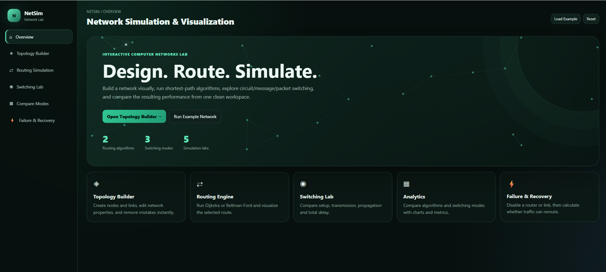
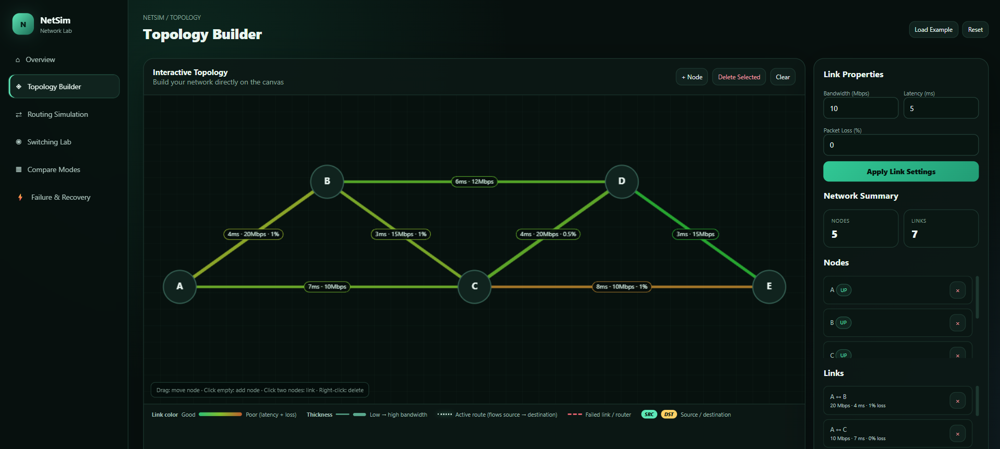
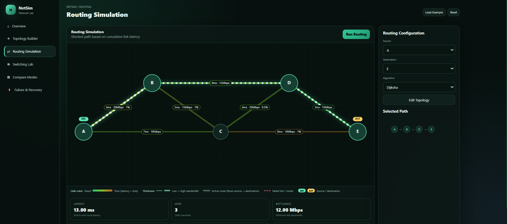
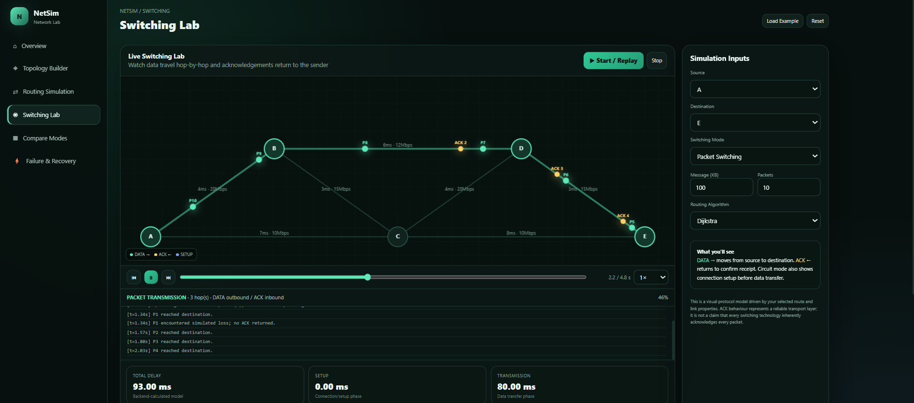
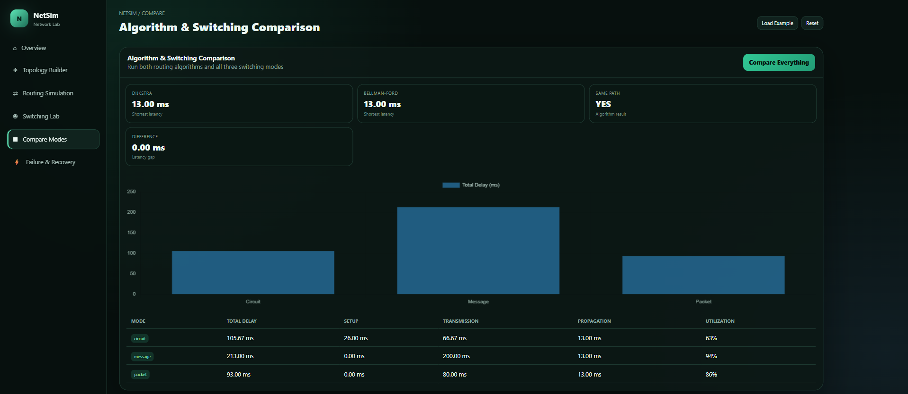
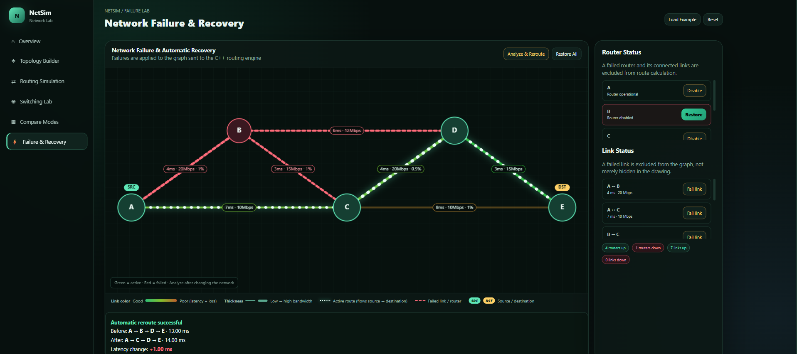

# 🌐 NetSim — Network Simulation & Visualization Tool

**NetSim** is an interactive network simulation and visualization tool designed to demonstrate fundamental concepts of Computer Networks. It allows users to build custom network topologies, execute routing algorithms, simulate different switching techniques, compare network performance, and analyze network failures.

The project combines a **C++ algorithm engine**, a **Python FastAPI backend**, and an interactive **HTML, CSS, and JavaScript frontend** to provide a visual learning environment for understanding network routing and switching.

---

## 📸 Screenshots


### Overview


### Topology Builder


### Routing Simulation


### Switching Lab


### Compare Modes 


### Failure and Recovery


---

## ✨ Key Features

### 1. Interactive Network Topology Builder
- Create network nodes and establish connections between them.
- Configure link properties such as bandwidth, latency, and packet loss.
- Select and delete nodes or links.
- Load an example network for quick experimentation.
- Visualize the network topology on an interactive canvas.

### 2. Routing Algorithms
NetSim implements two fundamental shortest-path routing algorithms:

- **Dijkstra's Algorithm:** Finds the shortest path based on cumulative link latency.
- **Bellman-Ford Algorithm:** Computes shortest paths through iterative edge relaxation.

The application displays the selected route along with important network metrics.

### 3. Switching Simulation

Explore and compare three major switching techniques:

- **Circuit Switching**
- **Message Switching**
- **Packet Switching**

The simulation demonstrates data transmission across network nodes and provides a visual representation of the communication process.

### 4. Performance Comparison
Compare routing algorithms and switching techniques using calculated network metrics.

The dashboard presents:
- Total transmission delay
- Setup delay
- Transmission delay
- Propagation delay
- Link utilization

Charts and comparison tables make it easier to understand the performance differences.

### 5. Network Failure & Recovery
- Simulate router failures by disabling individual nodes.
- Simulate link failures by disabling network connections.
- Analyze whether the destination remains reachable.
- Observe the route selected after a failure.
- Restore disabled nodes and links.

---

## 🛠️ Technology Stack

| Component | Technologies |
|---|---|
| Frontend | HTML, CSS, JavaScript |
| Charts | Chart.js |
| Backend | Python, FastAPI |
| Algorithm Engine | C++ |
| Python-C++ Integration | pybind11 |
| API Communication | REST API, JSON |

### Why this combination?

- **C++** handles computational logic and graph algorithms.
- **Python + FastAPI** manages API requests, input validation, and communication between the frontend and algorithm engine.
- **HTML, CSS, and JavaScript** provide the interactive user interface and visualizations.
- **pybind11** connects the C++ algorithm implementation with Python.

---

## 🧠 Algorithms & Concepts

### Routing Algorithms

| Algorithm | Purpose | Time Complexity |
|---|---|---|
| Dijkstra | Finds the shortest path using non-negative edge weights | O((V + E) log V) with a priority queue |
| Bellman-Ford | Finds shortest paths through repeated edge relaxation | O(V × E) |

Here:
- V = Number of vertices (nodes)
- E = Number of edges (links)

**Routing metric:** NetSim uses cumulative link latency as the edge weight when determining the shortest path.

### Network Metrics

The routing engine calculates:

- **Total Latency:** Sum of link latencies along the selected path.
- **Bottleneck Bandwidth:** Minimum bandwidth among the links in the selected path.
- **Cumulative Packet Loss:** Combined packet-loss probability across the links in the path.

### Switching Delay Simulation

NetSim calculates the following delay components:

- Setup Delay
- Transmission Delay
- Propagation Delay
- Total Delay

The simulation uses simplified mathematical models to demonstrate the differences between switching techniques.

#### Circuit Switching

- Setup Delay = 2 × Total Path Latency
- Transmission Delay = Message Size / Bottleneck Bandwidth
- Propagation Delay = Total Path Latency

**Total Delay = Setup + Transmission + Propagation**

#### Message Switching

- Setup Delay = 0
- Transmission Delay = Per-hop Transmission Delay × Number of Hops
- Propagation Delay = Total Path Latency

**Total Delay = Transmission + Propagation**

#### Packet Switching

The message is divided into smaller packets.

- Setup Delay = 0
- Transmission Delay = Per-packet Transmission Time × (Number of Packets + Number of Hops − 1)
- Propagation Delay = Total Path Latency

**Total Delay = Transmission + Propagation**

*Note: These are simplified educational models, not measurements from a real network. The implementation uses the path's bottleneck bandwidth for transmission-delay calculations.*

---

## 🏗️ Project Architecture

NetSim follows a three-layer architecture:

```text
             USER
              |
              v
    +---------------------+
    |      FRONTEND       |
    |    HTML / CSS / JS  |
    |     Chart.js        |
    +---------------------+
              |
         REST API
           JSON
              |
              v
    +---------------------+
    |       BACKEND       |
    |    Python / FastAPI |
    |                     |
    |  Request Validation |
    |  API Management     |
    +---------------------+
              |
         pybind11
              |
              v
    +---------------------+
    |   C++ ALGORITHM     |
    |       ENGINE        |
    |                     |
    |      Dijkstra       |
    |    Bellman-Ford     |
    |  Switching Models   |
    +---------------------+
```

The frontend sends simulation requests to the FastAPI backend. The backend validates the input and invokes the compiled C++ module through pybind11. The results are returned as JSON and displayed in the frontend.

---

## 📁 Project Structure

```text
NetSim/
│
├── index.html
│
├── server.py
│
├── algo/
│   ├── netsim_algo.cpp
│   └── netsim_algo.pyd       # Generated during compilation
│
├── screenshots/
│   ├── overview.png
│   ├── topology.png
│   ├── routing.png
│   ├── compare.png
│   ├── failure.png
│   └── switching.png


│
├── requirements.txt
├── .gitignore
├── README.md
└── LICENSE
```

*The compiled `.pyd` file is generated locally and should not normally be committed to GitHub. The exact build configuration may add files such as `setup.py`, `pyproject.toml`, or `CMakeLists.txt`.*

---

## ⚙️ Installation & Setup

### Prerequisites

Make sure you have the following installed:

- Python 3.10 or later
- A C++17-compatible compiler
- Git
- pip
- pybind11

### Step 1: Clone the repository

```bash
git clone https://github.com/YOUR_USERNAME/NetSim-Network-Simulator.git
```

```bash
cd NetSim-Network-Simulator
```

### Step 2: Create a virtual environment

```bash
python -m venv .venv
```

Activate it on Windows:

```powershell
.venv\Scripts\Activate.ps1
```

### Step 3: Install Python dependencies

```bash
pip install -r requirements.txt
```

### Step 4: Compile the C++ module

The C++ source must be compiled into a Python extension module named `netsim_algo` and placed inside the `algo` directory.

Use the repository's build instructions for your operating system and Python version.

**Important:** The backend cannot start until this module has been compiled successfully.

---

## ▶️ Running the Project

After completing the installation and compilation steps:

### Start the backend

```bash
python server.py
```

The backend will start at:

```text
http://localhost:8000
```

### Open the frontend

Open `index.html` in your browser.

Make sure the backend is running before using the simulation features.

### API Documentation

FastAPI automatically generates interactive API documentation.

Visit:

```text
http://localhost:8000/docs
```

---

## 🔌 API Endpoints

| Method | Endpoint | Description |
|---|---|---|
| GET | `/api/health` | Checks backend availability |
| POST | `/api/route` | Calculates a route using the selected algorithm |
| POST | `/api/simulate` | Performs routing and switching simulation |
| POST | `/api/compare` | Compares routing algorithms and switching modes |
| POST | `/api/failure-analysis` | Analyzes routing before and after network failures |

---

## 🚀 Future Improvements

Potential improvements planned for future versions:

- Support for additional routing algorithms.
- More realistic network delay and congestion models.
- Dynamic packet loss and retransmission simulation.
- Support for larger network topologies.
- Improved real-time packet animation.
- Network traffic monitoring and advanced analytics.
- Deployment of the application for online access.

---

## 🎯 Learning Outcomes

Developing NetSim provided practical exposure to:

- Graph representation and graph traversal.
- Shortest-path routing algorithms.
- Fundamental concepts of Computer Networks.
- Circuit, message, and packet switching.
- Performance analysis of network communication.
- REST API development using FastAPI.
- Integrating C++ with Python using pybind11.
- Frontend-backend communication.
- Interactive data visualization.

---

## 👨‍💻 Author

**Samarth Gupta**

B.Tech — Computer Science and Engineering

Madhav Institute of Technology & Science, Gwalior

GitHub: https://github.com/YOUR_USERNAME

---

## 📄 License

This project is licensed under the MIT License. See the `LICENSE` file for details.
```

## A few things to complete before publishing

There are some important details I would not leave unfinished:

| Item | What you should do |
|---|---|
| Screenshots | Capture actual screenshots of your application and save them in `screenshots/`. |
| README images | Make sure image filenames match the paths in the README. |
| Build instructions | Add the exact Windows C++ compilation command or build script you use successfully. |
| `requirements.txt` | Include the actual Python dependencies required by your backend and build process. |
| License | Add an actual `LICENSE` file if you claim the project is MIT licensed. |
| GitHub URL | Replace `YOUR_USERNAME` with your GitHub username. |
| Demo video | Consider adding a short GIF or video showing the simulator working. |

### My recommendation

**The three most important things for your GitHub portfolio are:**

1. **A good README with screenshots** — visitors should understand the project within 30 seconds.
2. **A working installation guide** — someone should be able to clone and run it without contacting you.
3. **A short demo GIF/video** — show topology creation, routing, and switching simulation in action.

One technical point: your current backend expects `server.py` at the project root and the compiled C++ module inside the adjacent `algo/` directory. Keep that structure unless you also update the import path.

I can next help you create the actual `README.md` file and make sure its installation instructions match your Windows setup.